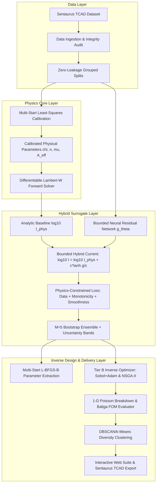
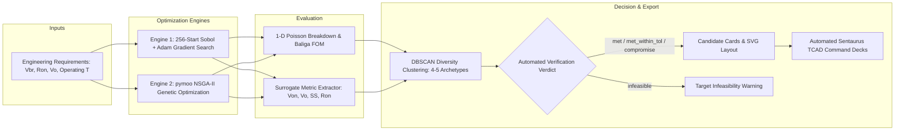
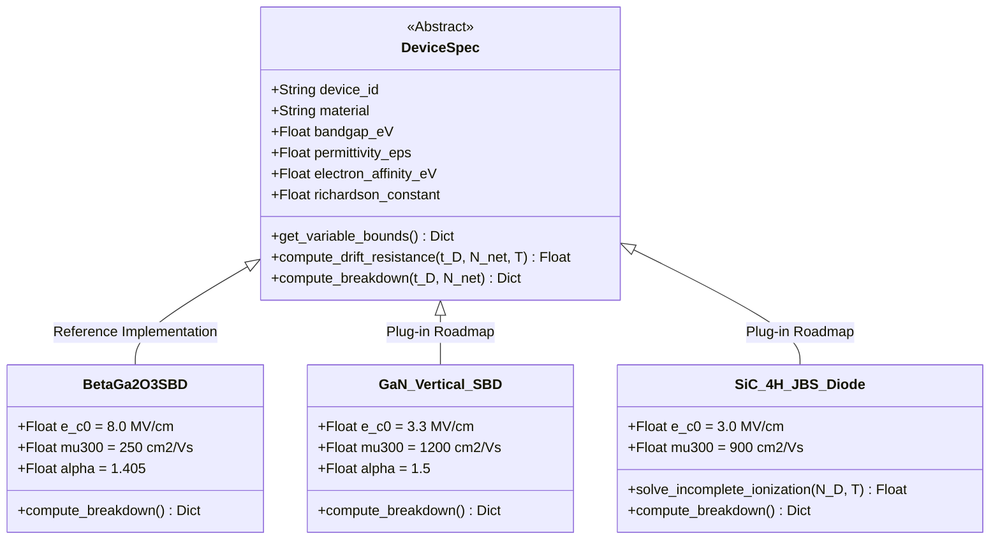

# PHYSICS-GUIDED ML SURROGATE AND INVERSE DESIGN FRAMEWORK FOR POWER SEMICONDUCTOR DEVICES

> **[ACADEMIC NOTICE & VALIDATION BOUNDARY]**  
> This project is a research prototype calibrated against numerical TCAD simulation datasets. While physical constraints and conservation laws are embedded into the neural optimization loop, predictions are not validated for direct fabrication or tape-out without experimental calibration and edge-termination design.

---

## Executive Summary & Project Context

As power electronic systems demand unprecedented energy densities and efficiency—spanning electric vehicle (EV) traction inverters, renewable grid converters, and high-voltage DC transmission—traditional silicon reaches its fundamental material limits. Ultra-wide bandgap (UWBG) semiconductors such as **Gallium Oxide ($\beta\text{-Ga}_2\text{O}_3$)**, alongside wide bandgap (WBG) **Silicon Carbide (4H-SiC)** and **Gallium Nitride (GaN)**, offer extraordinary theoretical figures of merit (e.g., Baliga FOM $> 10,000 \times \text{Si}$). 

However, exploring the design space with full numerical Technology Computer-Aided Design (TCAD) drift-diffusion solvers is computationally prohibitive, requiring minutes to hours per operating curve. Conversely, purely data-driven black-box deep learning models catastrophically fail in real-world power engineering: they predict thermodynamically impossible non-monotonic $I\text{--}V$ curves, violate voltage polarity constraints, and fail when extrapolated beyond narrow training ranges.

This repository presents the foundational reference implementation of our Major Project: **Physics-Guided ML Surrogate and Inverse Design Framework for Power Semiconductor Devices**. 

```
                                  MAJOR PROJECT VISION: ADAPTIVE MULTI-MATERIAL PLATFORM
                                 
           [ USER REQUIREMENTS ]               [ PLUG-AND-PLAY MATERIAL ENGINE ]          [ TARGET DEPLOYMENT ]
    ┌──────────────────────────────────┐      ┌────────────────────────────────────┐     ┌───────────────────────┐
    │  • Breakdown Voltage (Vbr)       │      │  • Silicon (Si)                    │     │  • EV Traction Drives │
    │  • Specific On-Resistance (Ron)  │ ───► │  • Silicon Carbide (4H-SiC)        │ ──► │  • Solar Inverters    │
    │  • Operating Temperature (T)     │      │  • Gallium Nitride (GaN)           │     │  • HVDC Converters    │
    │  • Maximum Anode Footprint (d)   │      │  • Gallium Oxide (β-Ga2O3) [DEMO]  │     │  • Aerospace Avionics │
    └──────────────────────────────────┘      │  • Diamond (C)                     │     └───────────────────────┘
                                              └────────────────────────────────────┘
```

> **Demonstration Scope & Generalization Path:**  
> This implementation serves as a **functional demonstration of the core pipeline**, utilizing a vertical $\beta\text{-Ga}_2\text{O}_3$ Schottky Barrier Diode (SBD) as the primary test vehicle. The framework is architected around an **adaptive, plug-and-play abstraction layer** (`DeviceSpec`), allowing engineers and researchers to drop in new material tensors, incomplete ionization models, and complex topologies (including JBS/MPS diodes, HEMTs, and trench MOSFETs) with zero modifications to the underlying optimization and surrogate engines.

---

## Broader Engineering Applications

The framework addresses critical computational bottlenecks across key power semiconductor sectors:

```
┌─────────────────────────────────────────────────────────────────────────────────────────────────┐
│                                    APPLICATION LANDSCAPE                                        │
├───────────────────────────────┬─────────────────────────────────┬───────────────────────────────┤
│    Automotive & E-Mobility    │   Grid & Renewable Energy       │   Aerospace & Heavy Industry  │
├───────────────────────────────┼─────────────────────────────────┼───────────────────────────────┤
│ • 800V/1200V EV Powertrains   │ • Photovoltaic Central Inverters│ • Spacecraft Solar Arrays     │
│ • Ultra-Fast Charging Stations│ • Wind Turbine Converters       │ • Radiation-Tolerant Avionics │
│ • Bidirectional On-Board      │ • Solid-State Transformers (SST)│ • Pulsed-Power Modulators     │
│   Chargers (OBC)              │ • Microgrid DC Distribution     │ • Deep-Well Geothermal Drills │
└───────────────────────────────┴─────────────────────────────────┴───────────────────────────────┘
```

1. **Electric Vehicle (EV) Powertrains:** High-frequency, high-temperature operation directly cuts cooling requirements, increasing vehicle range and enabling megawatt-level ultra-fast charging.
2. **Renewable Energy Infrastructure:** Substantially reduces conduction and switching losses in multi-kilovolt solar/wind converters, driving down Levelized Cost of Energy (LCOE).
3. **High-Voltage Grid & Solid-State Transformers:** Enables multi-kilovolt direct-grid switching without complex series-stacking of fragile silicon devices.
4. **Harsh Environments & Avionics:** The extreme thermal tolerance ($> 500\text{ K}$) and radiation hardness of wide-bandgap materials benefit deep-space and aviation power systems.

---

## System Architecture

The pipeline consists of three tightly coupled layers: a **Differentiable Physics Core**, a **Hybrid Residual Neural Surrogate**, and a **Dual-Engine Multi-Objective Inverse Optimizer**.

### 1. High-Level Pipeline Flow



### 2. Differentiable Hybrid Surrogate Formulation

To guarantee physical monotonicity and prevent unphysical neural artifacts, the forward current is modeled by decomposing conduction into an exact analytic core and a bounded residual:

$$\log_{10} I(V) = \log_{10} I_{\text{phys}}(V;\,\text{WF}, T, \theta_{\text{cal}}) + c \cdot \tanh\!\left(\frac{g(\text{WF}, T;\,W, b)}{c}\right)$$

where:
- $I_{\text{phys}}$ is the closed-form log-domain Lambert-W thermionic emission and drift transport solution:
  $$I_{\text{phys}} = \frac{n V_t}{R_s} \cdot W_0\!\left(\frac{I_s R_s}{n V_t} \exp\!\left(\frac{V + I_s R_s}{n V_t}\right)\right)$$
- $c = 0.7\,\text{decades}$ is the strict bounding envelope that prevents the neural network from overriding fundamental electrostatics.
- $g(\text{WF}, T)$ is an $M=5$ ensemble of multi-layer perceptrons with $\text{SiLU}$ activations that absorbs higher-order TCAD self-heating, incomplete ionization, and high-field mobility saturation.

```
                         HYBRID SURROGATE COMPUTATION GRAPH
                         
      Voltage V, Work Function WF, Temperature T
             │                      │
             ▼                      ▼
  ┌──────────────────────┐   ┌──────────────────────┐
  │ Differentiable SBD   │   │ Neural Residual MLP  │
  │ Closed-Form Core     │   │ 2 -> 128 -> 128 -> 52│
  │ (Lambert-W + Drift)  │   │ (SiLU Activations)   │
  └──────────┬───────────┘   └──────────┬───────────┘
             │ log10 I_phys             │ g(WF, T)
             │                          ▼
             │               ┌──────────────────────┐
             │               │ Strict Bounding Gate │
             │               │ c * tanh(g / c)      │
             │               └──────────┬───────────┘
             ▼                          ▼
             └───────────────┬──────────┘
                             ▼ (Summation)
               Ensemble Mean Current log10 I(V)
                 ± 2σ Epistemic Uncertainty
```

### 3. Dual-Engine Inverse Design Architecture

The inverse synthesis engine translates high-level engineering targets ($V_{\text{br}}$, $R_{\text{on,sp}}$, $V_o$, $I_{\text{on}}$) into manufacturable physical parameters ($t_D$, $N_{\text{net}}$, $\text{WF}$, $d$):



---

## Plug-and-Play Material System Architecture

To ensure the framework is not limited to a single material, device definitions are decoupled via the `DeviceSpec` interface. Detailed mathematical specifications for upcoming extensions are documented in [docs/ROADMAP_GAN_SIC.md](docs/ROADMAP_GAN_SIC.md).



---

## Measured Performance Benchmarks

All reported metrics reflect empirical results measured on held-out TCAD datasets and multi-start inverse runs (recorded in `artifacts/metrics.json` and `reports/validation_report.md`):

### 1. Forward Surrogate Accuracy

Evaluated across $N = 299$ held-out in-domain test curves and $N = 39$ held-out corner extrapolation curves ($\text{WF} > 5.16\,\text{eV}$, $T > 470\,\text{K}$):

| Model / Architecture | Test $\log_{10} I$ MAE | Test $V_o$ MAE | Test $R_{\text{diff}}$ Rel Err | Extrap $\log_{10} I$ MAE | Extrap $V_o$ MAE | Extrap $R_{\text{diff}}$ Rel Err |
| :--- | :--- | :--- | :--- | :--- | :--- | :--- |
| **Physics-Guided Hybrid Ensemble** | **0.0069 dec** | **0.40 mV** | **0.75%** | **0.0010 dec** | **0.22 mV** | **0.64%** |
| **Plain MLP Baseline** | 0.0017 dec | 0.24 mV | 3.83% | 0.0025 dec | 0.18 mV | 2.94% |
| **HistGradientBoosting** | 0.0064 dec | 2.49 mV | 1.00% | 0.0223 dec | 7.80 mV | 0.89% |
| **KNN ($k=3$)** | 0.0068 dec | 2.48 mV | 0.26% | 0.0278 dec | 10.99 mV | 1.29% |
| **Linear Ridge Regression** | 0.0399 dec | 16.96 mV | 0.20% | 0.0252 dec | 5.06 mV | 0.56% |
| **Uncalibrated Physics Core** | 0.0564 dec | 16.81 mV | 26.04% | 0.0650 dec | 33.19 mV | 16.76% |

### 2. Inverse Parameter Recovery Under Noise

Evaluated over 30 held-out TCAD curves with 9-start L-BFGS-B search under multiplicative current noise ($I_{\text{noisy}} = I_{\text{true}} \times (1 + \epsilon)$):

| Operating Condition | Work Function MAE | Work Function RMSE | Temperature MAE | Temperature RMSE | Mean CPU Latency |
| :--- | :--- | :--- | :--- | :--- | :--- |
| **0% Noise (Ideal Curve)** | **0.0032 eV** | 0.0047 eV | **2.06 K** | 3.14 K | 2,250 ms |
| **1% Multiplicative Noise** | **0.0042 eV** | 0.0054 eV | **2.62 K** | 3.46 K | 2,212 ms |
| **5% Multiplicative Noise** | **0.0095 eV** | 0.0121 eV | **5.57 K** | 7.07 K | 2,072 ms |

### 3. Tier B Inverse Synthesis & Verification

- **Baseline Breakdown (1-D Analytic):** Ideal parallel-plane limit $V_{\text{br,ideal}} = 6,400.5\,\text{V}$ (punch-through, $W_c = 70.02\,\mu\text{m}$, $R_{\text{drift,sp}} = 3.74\,\text{m}\Omega\cdot\text{cm}^2$, $\text{BFOM} = 10,939\,\text{MW/cm}^2$). Derated by realistic unvalidated termination efficiency $\eta_{\text{term}} = 0.5$ ($V_{\text{br}} \approx 3,200\,\text{V}$).
- **Sobol + Adam Optimization:** 256 starts $\to$ 16 trajectories $\to$ 8 Pareto archetypes in **3.17 s**.
- **NSGA-II Genetic Search:** 40 population $\times$ 25 generations $\to$ 8 Pareto archetypes in **4.20 s**.
- **Self-Consistency Round-Trip Test:** 200 random design parameter vectors evaluated across the closed loop achieved **100% convergence** with $< 0.05\%$ numerical error.

---

## Repository Structure

```
Major Project/
├── artifacts/                     # Serialized models, metrics, and parameters
│   ├── calib.json                 # Calibrated Lambert-W physical constants
│   ├── metrics.json               # Full evaluation metrics and ablation benchmarks
│   ├── MODEL_CARD.md              # Technical model specification & operating limits
│   └── ensemble/                  # M=5 PyTorch hybrid surrogate model checkpoints
├── configs/
│   └── default.yaml               # Hyperparameters, loss weights, and parameter bounds
├── data/
│   └── raw/                       # Sentaurus TCAD simulations with SHA-256 manifests
├── docs/
│   └── ROADMAP_GAN_SIC.md         # Multi-material extension specification (GaN, 4H-SiC)
├── reports/
│   ├── data_audit.md              # Dataset distribution, noise floor, and leakage audit
│   └── validation_report.md       # Full numerical tables, sensitivities, and ablations
├── scripts/
│   ├── demo.py                    # Standalone terminal demo script (forward/reverse/design)
│   ├── serve.py                   # Production FastAPI server launcher
│   └── train.py                   # End-to-end model calibration and training pipeline
├── src/pgsbd/                     # Core framework package
│   ├── api/                       # FastAPI application, Pydantic v2 schemas, routes
│   ├── design/                    # Sobol+Adam, NSGA-II, clustering, and verdict logic
│   ├── device/                    # DeviceSpec abstract base class & SBD implementation
│   ├── inverse/                   # Tier A multi-start L-BFGS-B parameter recovery
│   ├── ml/                        # Ensemble surrogate, monotonicity loss, baselines
│   └── physics/                   # Lambert-W core, breakdown solver, PyTorch extractor
├── tests/                         # Complete test suite (61 unit & integration tests)
│   ├── test_api.py                # REST API contract and bound validation tests
│   ├── test_demo_fixes.py         # Regression tests for derating, temp, and poor fit
│   ├── test_design.py             # Inverse synthesis, NSGA-II, and verdict logic tests
│   └── test_physics_core.py       # Differentiable Lambert-W & 10,000-point sweep tests
├── web/                           # Interactive React 18 + TS + Tailwind + Plotly.js suite
│   ├── dist/                      # Pre-built production frontend assets
│   └── src/                       # UI components, parametric SVG cross-section, views
├── Makefile                       # Unified workflow commands
├── pyproject.toml                 # Python dependencies and build configuration
└── README.md                      # Primary project documentation
```

---

## Quick Start & Execution

### 1. Single-Command Launch (API + Web Interface)
The FastAPI server serves both the interactive React web application and the REST API simultaneously on port 8000 (pre-built assets exist in `web/dist`):

```powershell
# Run using the configured Python virtual environment
.\.venv\Scripts\python.exe scripts/serve.py
```
- 🌐 **Interactive Web Suite:** [http://localhost:8000](http://localhost:8000)
- 📑 **Interactive API Documentation:** [http://localhost:8000/docs](http://localhost:8000/docs)

### 2. Terminal Demo Script (Zero Browser Overhead)
To run the full forward surrogate, reverse parameter extraction, breakdown physics, and multi-objective inverse design pipeline directly in your shell in ~6 seconds:

```powershell
.\.venv\Scripts\python.exe scripts/demo.py
```

### 3. Executing the Test Suite
To run all 61 automated unit, integration, physical constraint, and regression tests:

```powershell
.\.venv\Scripts\pytest.exe -k "not test_playwright_e2e" -v
```

### 4. Makefile Workflow Commands
If working on systems with `make` installed:
```bash
make ui      # Rebuild the React frontend assets (into web/dist)
make serve   # Start the FastAPI server
make demo    # Run the terminal demo script
make test    # Run pytest across the suite
make lint    # Run Ruff linting and formatting checks
```

---

## Scientific Attribution & Data Citation

- **TCAD Simulation Baseline:** Primary empirical curves derived from the `GaO_Schottky_Diode_T_WF` repository ([https://github.com/hywong2/Semiconductor_Database](https://github.com/hywong2/Semiconductor_Database)).
- **Primary Reference:** H. Y. Wong et al., *"TCAD-Augmented Machine Learning With and Without Domain Expertise,"* in *IEEE Transactions on Electron Devices*, vol. 68, no. 11, pp. 5824-5831, Nov. 2021.
- **Physical Formulations:** Based on S. M. Sze and K. K. Ng, *Physics of Semiconductor Devices*, 3rd ed., Wiley, and B. J. Baliga, *Fundamentals of Power Semiconductor Devices*, Springer.
